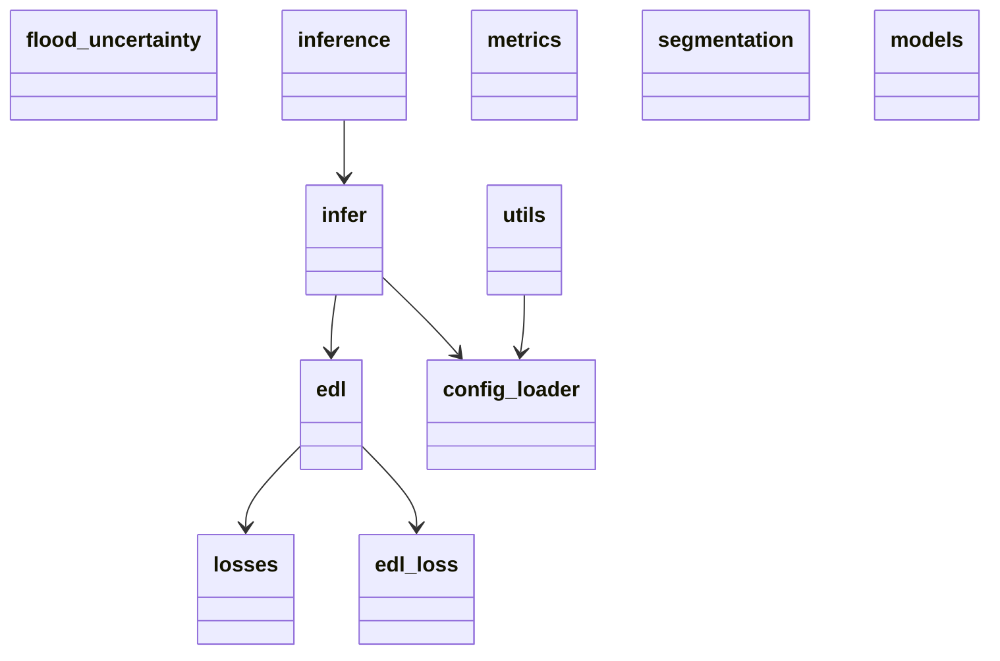
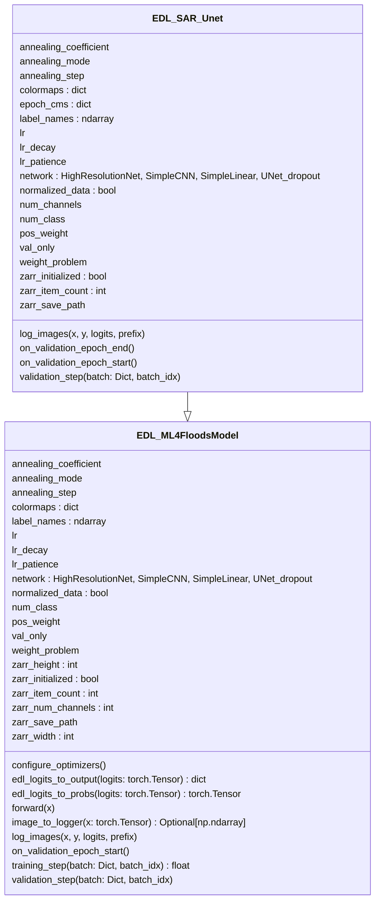

# Architecture Diagrams

> `pyreverse` makes the Mermaid diagrams in this document from a static analysis of the code. **Do not edit the content in the marker blocks by hand.**
> When the code changes, make the diagrams again:
>
> ```bash
> bash scripts/dev/gen_diagrams.sh
> ```
>
> If the diagrams and the code do not agree, the code is correct. Run the command above again.

---

## 1. Module Dependencies

This diagram shows the dependencies between the modules of the core package `flood_uncertainty/`. The dependencies go in one direction and have no cycles.

<!-- BEGIN PACKAGE_DIAGRAM -->



<!-- END PACKAGE_DIAGRAM -->

**Key points**

- `config_loader` has the highest fan-in: `infer` and most scripts depend on it. It has the lowest fan-out: it depends only on `ml4floods`. This is the correct shape for an infrastructure module.
- In this diagram, `metrics.segmentation` is an isolated node. The core package does not depend on it. Only `scripts/eval` and `scripts/analysis` use it. This layering is intentional: evaluation is not on the critical path of training or inference.
- This diagram does not show the `scripts/` layer. `flood_uncertainty` is not yet declared as an installable package (`pyproject.toml` has no `[build-system]`). The scripts can import it only through `sys.path.insert` at runtime. Static analysis tools cannot track this.

---

## 2. Class Structure

This is the class diagram of `flood_uncertainty/models/edl.py`.

<!-- BEGIN CLASS_DIAGRAM -->



<!-- END CLASS_DIAGRAM -->

**Key points**

- `EDL_SAR_Unet` declares almost all attributes of the parent class again. With normal inheritance, a subclass shows only its new members. Here, the only new members are `epoch_cms` and `num_channels`. The duplicate attributes show that the initialization logic is a copy. The subclass does not get it through `super().__init__()`.
- The six `zarr_*` attributes and `_init_zarr_structure()` / `_append_batch_to_zarr()` are a large part of the model class. Thus, the model class also does the work of a result writer. You can move this work into an independent component and attach it as a Lightning callback. Ensemble and MC dropout can then use this component too.
- The inferred type of `network` is a union of four concrete classes. This shows that `ml4floods.configure_architecture()` selects the backbone dynamically. There is no common abstract interface. The FM backbones (refer to [`foundation_model_integration.md`](./foundation_model_integration.md)) use a new, parallel model class and do not go through this factory. An abstract interface layer is an item for future improvement.

---

## 3. Related Documents

- [`BEF_integration_plan.md`](./BEF_integration_plan.md): the BEF fusion method
- [`foundation_model_integration.md`](./foundation_model_integration.md): integration of the foundation model backbone (decisions, code locations, milestones, risks)
