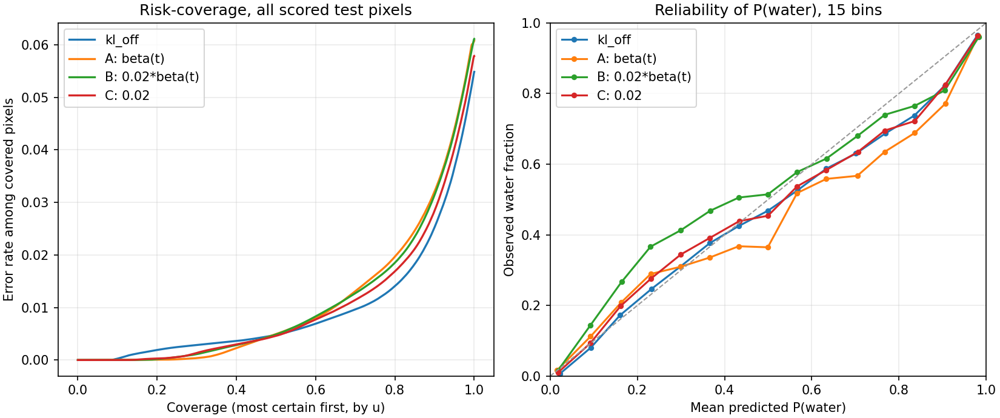
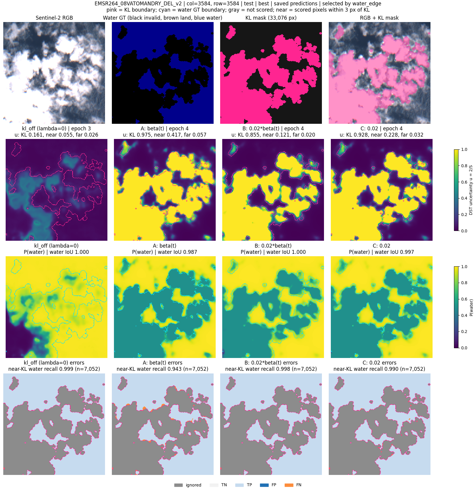
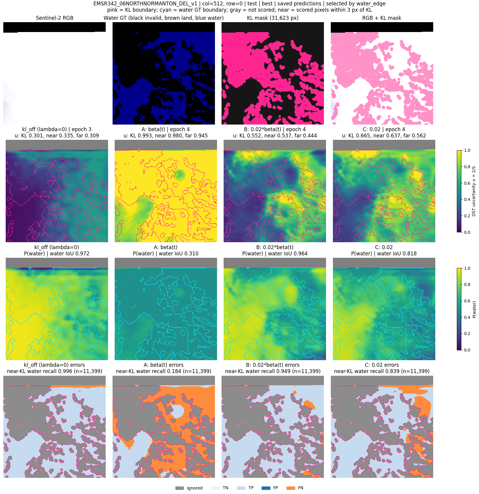
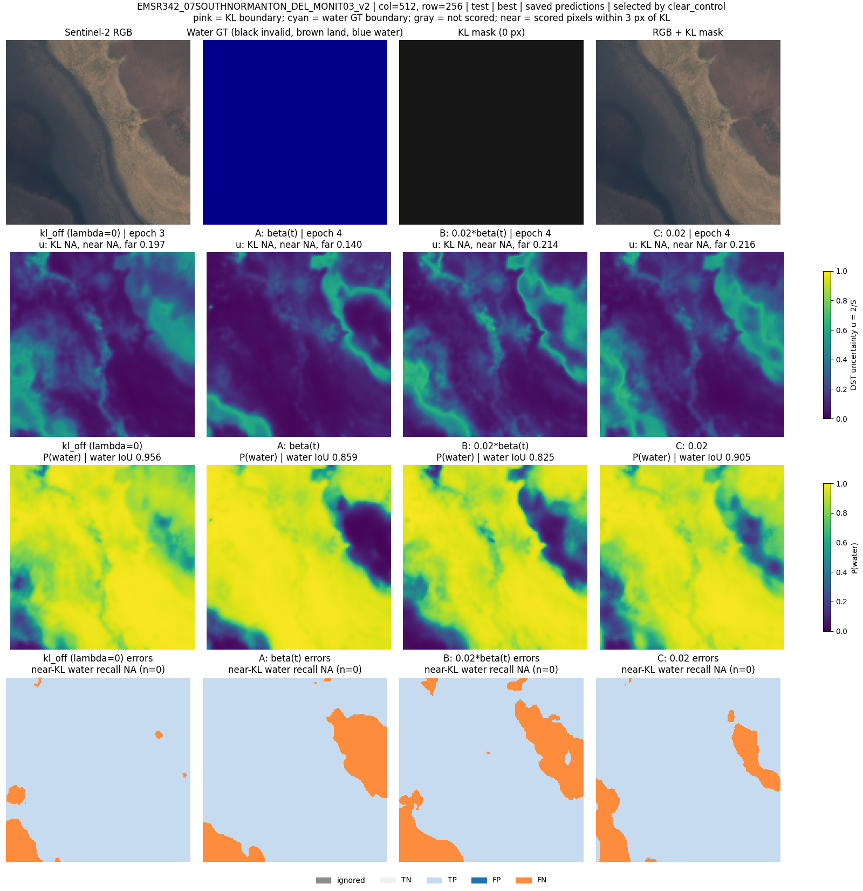
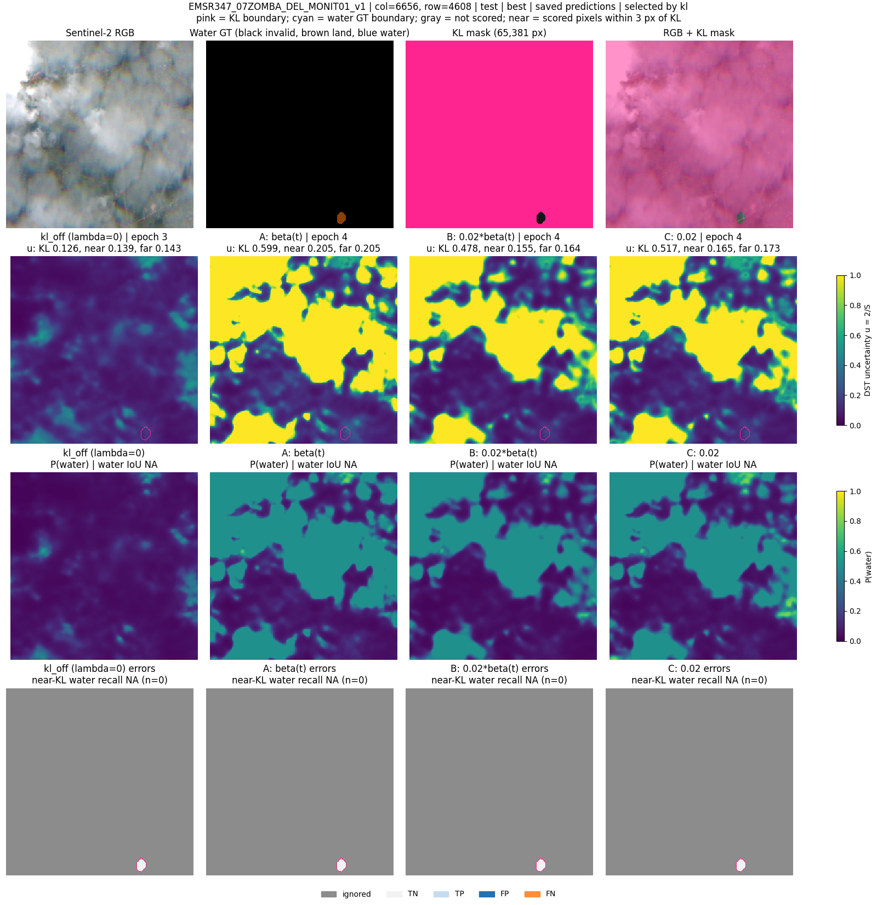
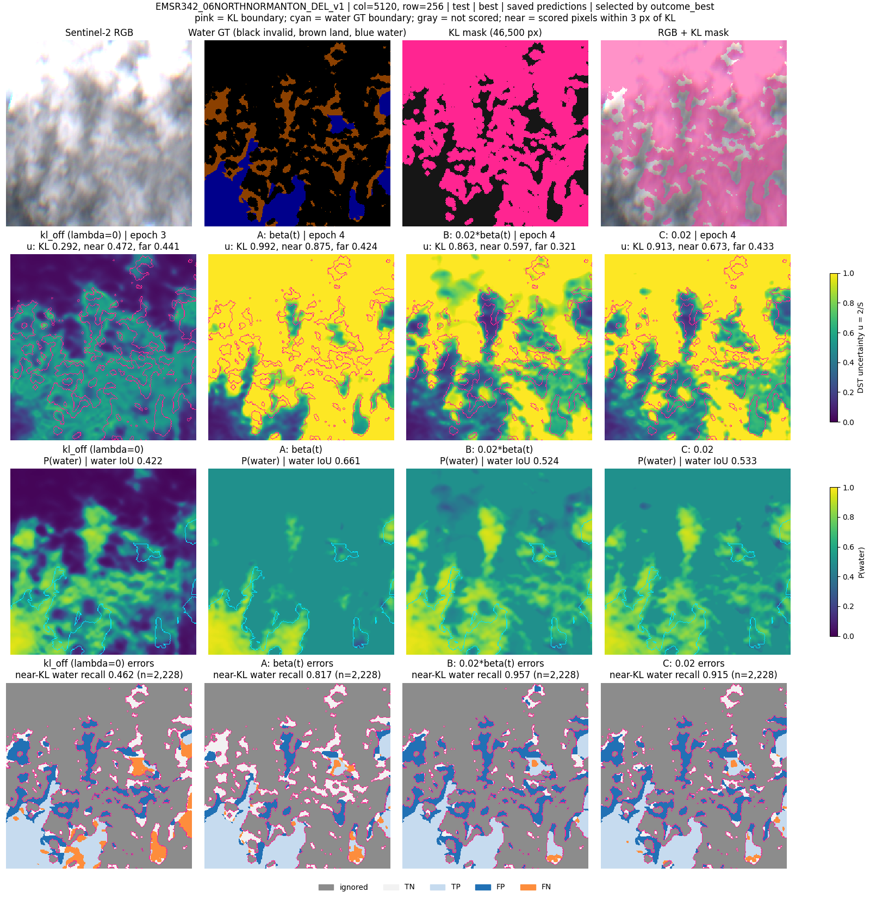
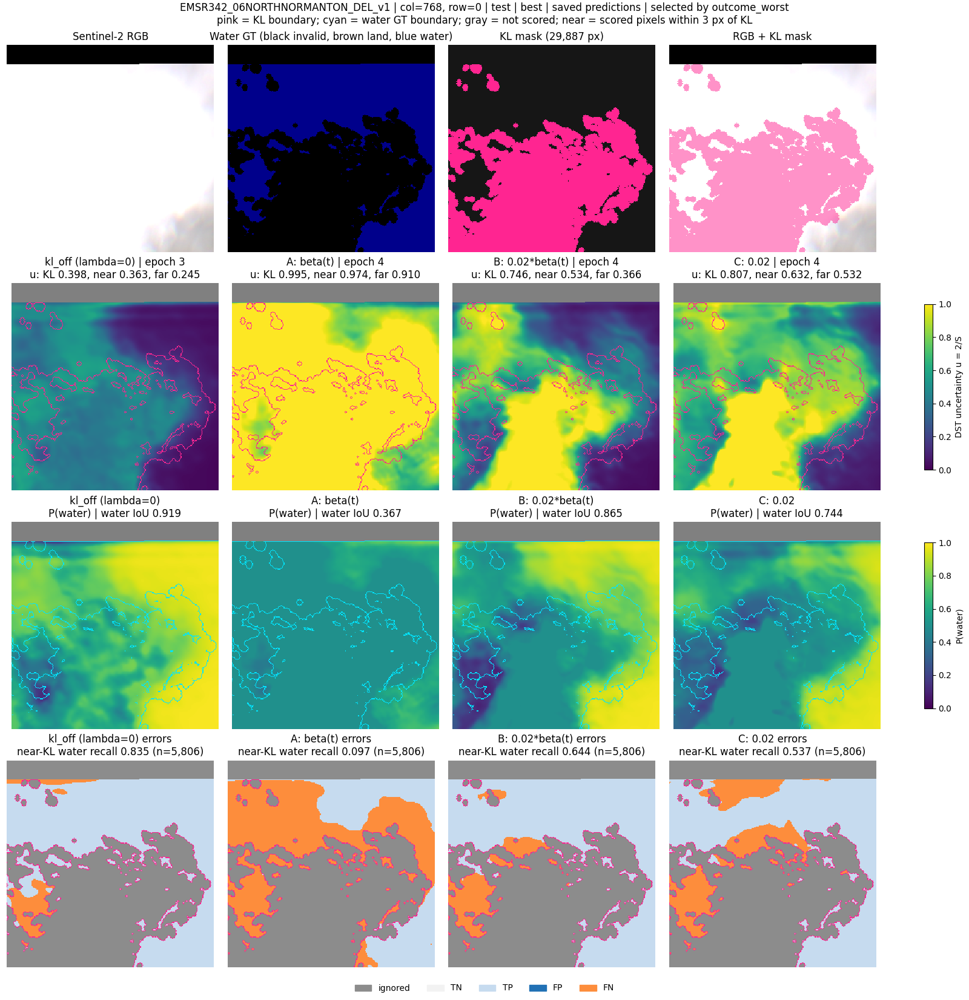
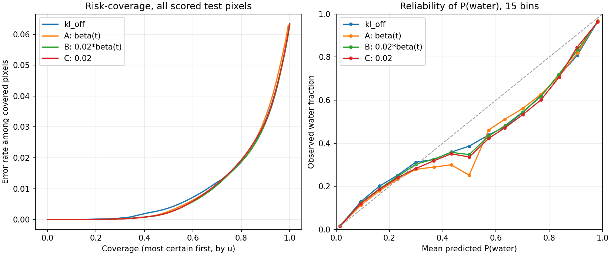

# Invalid-pixel KL for water-only EDL: ablation results

*2026-11-25 · WorldFloods v2 test split (18 events) · four arms, one seed each*

## Summary

- **The invalid-pixel KL raises u where it is applied.** On cloud-labelled KL pixels, median u is 0.08 without it (kl_off). With KL it is 0.74–1.00 at the best-validation checkpoints and 1.00 at the last epoch.
- **Primary result (best-validation checkpoints): all KL arms have lower overall recall.** C −0.006, A −0.022, B −0.028; all CIs exclude 0. All IoU differences are inconclusive. At the last epoch, the overall differences are inconclusive.
- **Near clouds, u is a worse error detector at both checkpoints.** Within 3 px of a KL pixel, the error-detection AP of u is lower in all three KL arms at both checkpoints; all six intervals exclude 0. This holds although C makes slightly fewer near-KL errors than kl_off.
- **A (λ = β(t)) shows the largest near-KL degradation.** Its AP and AUROC fall the most and its ECE rises the most. B and C are close.

## Setup

| | |
|---|---|
| Loss | `mean_valid EDL(α) + λ(t) · mean_KL KL(Dir(α) ‖ Dir(1,1))`. `EDL` already contains a misleading-evidence KL weighted by β(t) = min(1, epoch/10). |
| KL pixels | Input valid, inside the event AOI, and water label invalid. On test, these are essentially all cloud. |
| Arms | **kl_off**: λ = 0 · **A**: λ = β(t) · **B**: λ = 0.02 β(t) · **C**: λ = 0.02 |
| Training | U-Net with 6 S2 bands and two evidence channels, u = 2/S. Initialised from a cloud+water EDL model. 475 events, 65,582 windows, 30 epochs, batch 64, seed 42. |
| Checkpoints | **best**: lowest validation water BCE (kl_off epoch 3, A/B/C epoch 4, 0-based). **last**: epoch 29. |
| Test pixels | 167.1 M scored pixels: labelled land or water, and valid in all arms. **Near-KL** pixels are within 3 px of a KL pixel: 2.5 M pixels from 11 of the 14 events with an AOI. |
| Statistics | Water is predicted where P(water) > 0.5. Error detection scores "prediction ≠ label" by u. AUROC/AP/AURC are computed from 10,000 bins and match exact values within 5.3e-4. The 95% CIs come from a paired event bootstrap (2,000 resamples). |

## Results

### Table 1. Main metrics, best checkpoints (primary)

**What it shows:** test metrics pooled over all scored pixels, and over near-KL pixels only, for each arm. The last column is C − kl_off with its 95% CI.

**How to read it:** "Error" rows measure how well u ranks misclassified pixels above correct ones. The KL arms lose overall recall, and near-KL error-detection AP drops in every KL arm.

| Metric | kl_off | A | B | C | C − kl_off [95% CI] |
|---|---|---|---|---|---|
| IoU ↑ | 0.836 | 0.818 | 0.817 | 0.828 | −0.008 [−0.016, +0.004] |
| Precision ↑ | 0.901 | 0.901 | 0.904 | 0.897 | −0.004 [−0.017, +0.017] |
| Recall ↑ | 0.921 | 0.899 † | 0.894 † | 0.915 | **−0.006 [−0.017, −0.001]** |
| ECE ↓ | 0.020 | 0.017 | 0.018 | 0.017 | −0.003 [−0.013, +0.008] |
| Error AUROC ↑ | 0.888 | 0.876 | 0.880 | 0.883 | −0.005 [−0.015, +0.001] |
| Error AP ↑ | 0.334 | 0.286 | 0.311 | 0.312 | **−0.022 [−0.066, −0.007]** |
| AURC ↓ | 0.0093 | 0.0108 | 0.0107 | 0.0099 | +0.0006 [−0.0004, +0.0053] |
| Near-KL recall ↑ | 0.883 | 0.861 | 0.888 | 0.885 | +0.002 [−0.040, +0.018] |
| Near-KL ECE ↓ | 0.022 | 0.072 † | 0.024 | 0.030 | +0.009 [−0.006, +0.035] |
| Near-KL error AUROC ↑ | 0.851 | 0.778 † | 0.824 | 0.814 | −0.038 [−0.088, +0.001] |
| Near-KL error AP ↑ | 0.346 | 0.230 † | 0.296 † | 0.270 | **−0.076 [−0.191, −0.030]** |

↑/↓: higher/lower is better. † marks an arm whose difference from kl_off has a 95% CI that excludes 0. **Bold** marks a C − kl_off CI that excludes 0.

### Table 2. Same metrics, last epoch (sensitivity)

**What it shows:** Table 1 recomputed with each arm's epoch-29 weights, so that all arms have the same training length.

**How to read it:** for C, every overall CI includes 0, and A's overall error AP is still lower (†). Near KL, C has lower recall, error AUROC and AP, and higher ECE, with CIs that exclude 0. Of these, only AP was also lower at best.

| Metric | kl_off | A | B | C | C − kl_off [95% CI] |
|---|---|---|---|---|---|
| IoU ↑ | 0.814 | 0.815 | 0.817 | 0.816 | +0.001 [−0.001, +0.003] |
| Precision ↑ | 0.882 | 0.882 | 0.882 | 0.879 | −0.003 [−0.007, +0.003] |
| Recall ↑ | 0.914 | 0.914 | 0.917 | 0.919 | +0.005 [−0.001, +0.010] |
| ECE ↓ | 0.019 | 0.019 | 0.018 | 0.019 | −0.000 [−0.002, +0.002] |
| Error AUROC ↑ | 0.888 | 0.887 | 0.892 | 0.891 | +0.002 [−0.008, +0.014] |
| Error AP ↑ | 0.355 | 0.295 † | 0.346 | 0.343 | −0.011 [−0.054, +0.009] |
| AURC ↓ | 0.0104 | 0.0103 | 0.0098 | 0.0100 | −0.0004 [−0.0030, +0.0004] |
| Near-KL recall ↑ | 0.929 | 0.881 † | 0.927 † | 0.925 | **−0.005 [−0.006, −0.001]** |
| Near-KL ECE ↓ | 0.037 | 0.086 † | 0.058 † | 0.055 | **+0.018 [+0.003, +0.038]** |
| Near-KL error AUROC ↑ | 0.875 | 0.776 † | 0.845 | 0.840 | **−0.035 [−0.069, −0.008]** |
| Near-KL error AP ↑ | 0.423 | 0.209 † | 0.306 † | 0.283 | **−0.141 [−0.242, −0.063]** |

### Table 3. Uncertainty on KL pixels

**What it shows:** how uncertain each arm is on the pixels the KL term targets: 15.9 M cloud-labelled KL pixels on test.

**How to read it:** kl_off stays confident under clouds. The KL arms push u toward 1, more fully at the last epoch.

| | kl_off | A | B | C |
|---|---|---|---|---|
| Median u, best | 0.075 | 1.000 | 0.737 | 0.951 |
| Fraction u = 1, best | 0.000 | 0.643 | 0.398 | 0.490 |
| Median u, last | 0.079 | 1.000 | 1.000 | 1.000 |
| Fraction u = 1, last | 0.000 | 0.683 | 0.502 | 0.536 |

### Table 4. PAvPU, best checkpoints

**What it shows:** for 3 × 3 patches, how often "accurate" (patch IoU ≥ 0.9) coincides with "certain" (mean u below a threshold). Each row uses a different threshold. The values are descriptive; there are no CIs.

**How to read it:** there is no consistent ranking across thresholds. The per-image Q90 over prediction-valid pixels is unfair to the KL arms, because cloud pixels at u = 1 tie at the threshold. The label-valid row uses only land/water-labelled pixels and removes these ties.

| u threshold | kl_off | A | B | C |
|---|---|---|---|---|
| Validation retention curve, 90% | 0.810 | 0.839 | 0.794 | 0.808 |
| Per-image Q90, prediction-valid pixels | 0.840 | 0.813 | 0.807 | 0.815 |
| Per-image Q90, label-valid pixels | 0.843 | 0.837 | 0.824 | 0.836 |

### Figure 1. Risk–coverage and reliability, best checkpoints



**What it shows:** the left panel is a retention curve. Pixels are kept from the lowest u upward, and the curve gives the error rate among the pixels kept; the area under it is the AURC in Table 1. The right panel compares the predicted P(water) with the observed water fraction.

**How to read it:** among their most certain 30% of pixels, the KL arms make almost no errors, while kl_off already has some confident errors. From about 60% coverage on, the KL arms have more errors. At the last epoch the curves nearly coincide (Appendix C).

### Figures 2–3. Case studies, best checkpoints

**What they show:** 256 × 256 px windows chosen from labels and KL masks only.
- Row 1: RGB, water label, KL mask, overlay.
- Rows 2–4: u, P(water) and the error map for each arm (columns).

In the maps, gray means not scored, orange is a missed water pixel (FN) and dark blue a false alarm (FP).



**Figure 2, EMSR264 VATOMANDRY: the intended behaviour.**
- kl_off predicts water under the cloud with u ≈ 0.16.
- The KL arms reach a mean u of 0.855–0.975 on the cloud.
- Near-KL u rises from 0.055 to 0.417 for A and 0.228 for C.
- Patch IoU stays at 0.987–1.000.



**Figure 3, EMSR342 NORTHNORMANTON: the failure mode.**
- The window looks cloudy in RGB, yet much of it is labelled water.
- On its 11,399 near-KL water pixels, recall falls from 0.996 for kl_off to 0.184 for A, 0.949 for B and 0.839 for C.
- A's high u (0.98 near KL) and P(water) near 0.5 are consistent with evidence suppression on pixels that resemble KL pixels.

## Limitations

- **Attribution.** At the best checkpoints, kl_off and the KL arms come from different epochs (3 vs 4) and different β, so those differences are not due to KL alone.
- **Sample size.** One seed per arm. There are 18 test events, and only 10 of them contribute near-KL water pixels.
- **AP is not error count.** AP reflects how errors are ranked, not how many there are. C has slightly fewer near-KL errors than kl_off: 8.8% vs 9.0% at best, 9.0% vs 9.6% at last.

## Appendix

### A. Per-event water IoU (test)

**What it shows:** IoU per event, so that changes are not hidden by the pooled value.

**How to read it:** at best, changes range from −0.17 to +0.05 and C is better in 8 of 18 events. At last, most changes are within ±0.015 and C is better in 11 of 18. SOUTHNORMANTON holds 36% of the scored water, so it dominates the pooled IoU. † marks events without an AOI, which have no KL pixels at test time.

| Event | Water (M px) | kl_off | A | B | C | C − kl_off best | C − kl_off last |
|---|---|---|---|---|---|---|---|
| EMSR347 ZOMBA v2 | 0.13 | 0.751 | 0.596 | 0.627 | 0.581 | −0.169 | +0.055 |
| EMSR347 ZOMBA MONIT01 | 4.0 | 0.866 | 0.847 | 0.832 | 0.845 | −0.021 | +0.001 |
| EMSR286 ITUANGO NORTH † | 0.20 | 0.894 | 0.871 | 0.875 | 0.875 | −0.020 | +0.002 |
| EMSR342 SOUTHNORMANTON | 18.2 | 0.769 | 0.723 | 0.718 | 0.750 | −0.019 | +0.002 |
| EMSR347 MWANZA † | 0.69 | 0.676 | 0.648 | 0.672 | 0.662 | −0.014 | +0.014 |
| EMSR9284 YLITORNIO † | 0.42 | 0.766 | 0.815 | 0.748 | 0.757 | −0.009 | +0.001 |
| EMSR466 AOI01 | 0.90 | 0.746 | 0.725 | 0.720 | 0.738 | −0.008 | +0.007 |
| EMSR264 VATOMANDRY | 6.9 | 0.965 | 0.955 | 0.961 | 0.960 | −0.005 | −0.002 |
| EMSR419 AOI01 | 1.4 | 0.928 | 0.940 | 0.911 | 0.924 | −0.005 | −0.014 |
| EMSR438 AOI06 | 0.46 | 0.934 | 0.937 | 0.930 | 0.930 | −0.004 | −0.002 |
| EMSR438 AOI02 | 5.5 | 0.949 | 0.938 | 0.952 | 0.951 | +0.002 | +0.004 |
| EMSR273 GRILE | 0.29 | 0.922 | 0.930 | 0.927 | 0.928 | +0.006 | −0.002 |
| EMSR342 NORTHNORMANTON | 10.1 | 0.817 | 0.828 | 0.830 | 0.823 | +0.006 | +0.003 |
| EMSR422 AOI06 | 0.86 | 0.966 | 0.973 | 0.974 | 0.974 | +0.009 | −0.001 |
| EMSR333 PORTOPALO | 0.14 | 0.771 | 0.774 | 0.773 | 0.791 | +0.020 | −0.001 |
| EMSR286 ITUANGO SOUTH † | 0.06 | 0.788 | 0.831 | 0.834 | 0.824 | +0.036 | +0.000 |
| EMSR264 MIANDRIVAZO | 0.30 | 0.631 | 0.691 | 0.680 | 0.677 | +0.046 | −0.007 |
| EMSR333 RATTALORO | 0.22 | 0.787 | 0.839 | 0.816 | 0.835 | +0.048 | +0.006 |

### B. More case studies (best checkpoints)

**What they show:** one control window, one thick-cloud window, and two windows chosen by outcome. Their layout is the same as in Figures 2–3.



**SOUTHNORMANTON, clear sky, no KL pixels.** The KL arms miss turbid water with low u. IoU is 0.956 for kl_off, 0.859 for A, 0.825 for B and 0.905 for C. At the last epoch, C − kl_off for this event is only +0.002.



**ZOMBA, thick cloud.** kl_off is confident. The KL arms reach u = 1 on only part of the cloud: mean u on KL pixels is 0.48–0.60.




**Chosen by outcome:** the windows with the largest (+0.45) and smallest (−0.30) C − kl_off near-KL water recall. Both come from the same event, so the effect changes direction within one scene.

The contact sheets with all 35 label-selected windows, and the whole-event maps, are in `artifacts/eval/edl_water_kl_ablation/{case_studies/test_best_saved_20261125T082357Z,event_maps/test_best_20261125T110818Z}/`.

### C. Last-epoch supplements



**What it shows:** Figure 1 at the last epoch. The four retention curves and the reliability curves nearly overlap.

| PAvPU, last epoch | kl_off | A | B | C |
|---|---|---|---|---|
| Validation retention curve, 90% | 0.810 | 0.820 | 0.811 | 0.798 |
| Per-image Q90, prediction-valid pixels | 0.835 | 0.811 | 0.816 | 0.813 |
| Per-image Q90, label-valid pixels | 0.836 | 0.835 | 0.839 | 0.838 |

Pooled validation IoU for kl_off, A, B and C is 0.874, 0.876, 0.884 and 0.881 at best, and 0.862, 0.862, 0.861 and 0.861 at last.

### D. Reproduction

```bash
bash scripts/train/run_edl_water_kl_ablation.sh
bash scripts/analysis/run_kl_ablation_eval.sh                  # add CHECKPOINT=last for the last epoch
uv run python -m scripts.analysis.evaluate_kl_ablation --split val --check-exact
uv run python -m scripts.analysis.evaluate_kl_ablation --split test             # add --checkpoint last
uv run python -m scripts.eval.plot_val_kl_maps --split test --pred-root artifacts/results/edl_water_kl_ablation
uv run python -m scripts.eval.plot_kl_event_maps --split test
```

- **Numbers:** `artifacts/results/edl_water_kl_ablation/{best,last}/evaluation/test/*.csv`.
- **Checkpoints:** `{best,last}/<arm>/checkpoint.txt`.
- **Code version:** the commit that adds this report. To find it, run `git log -1 --format=%H -- docs/edl_water_kl_ablation_report/report.md`.
