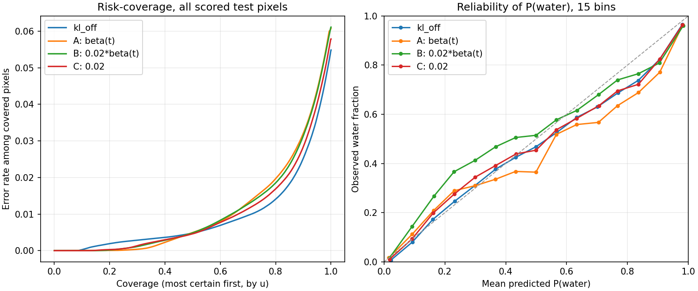
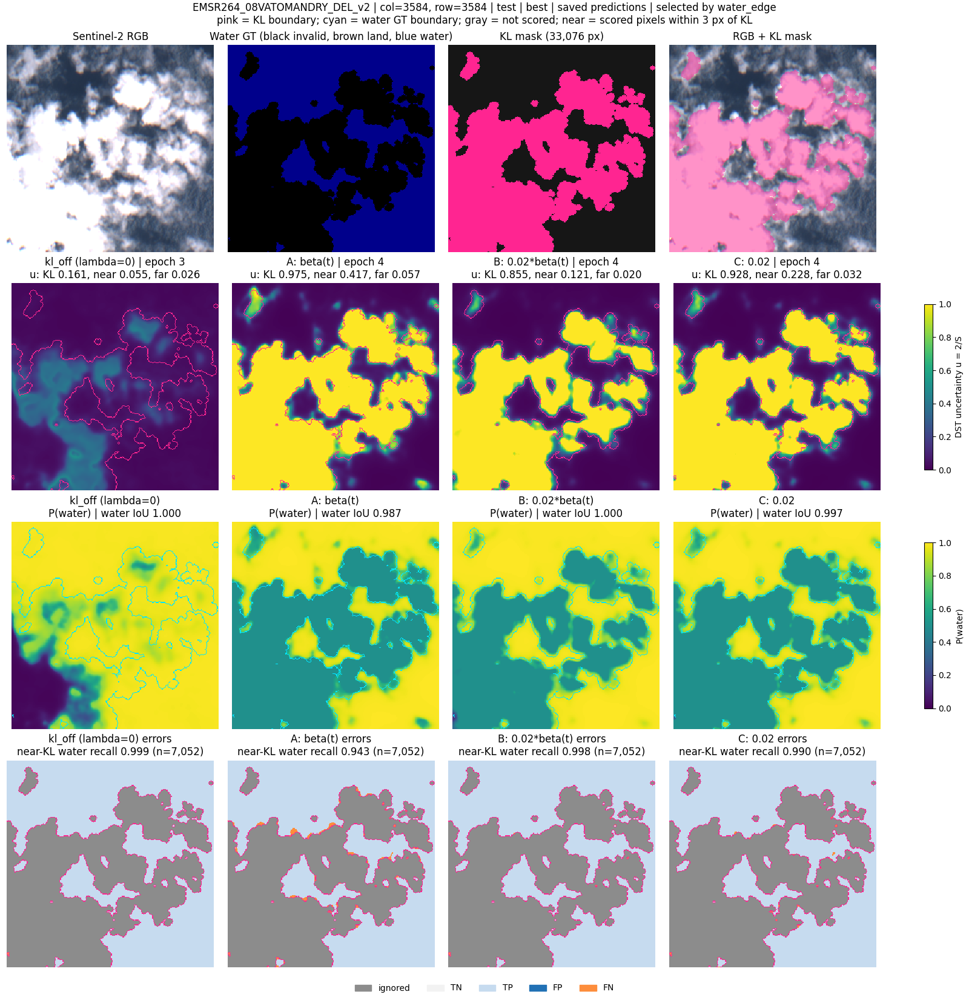
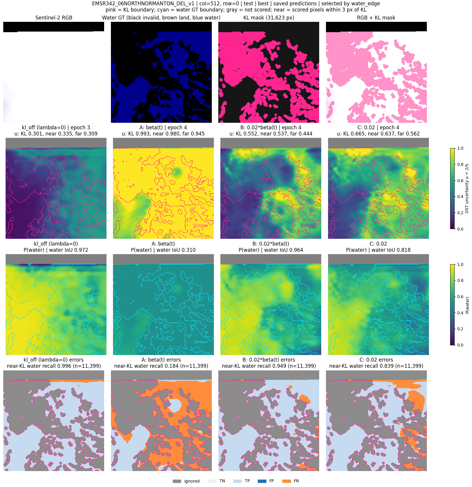
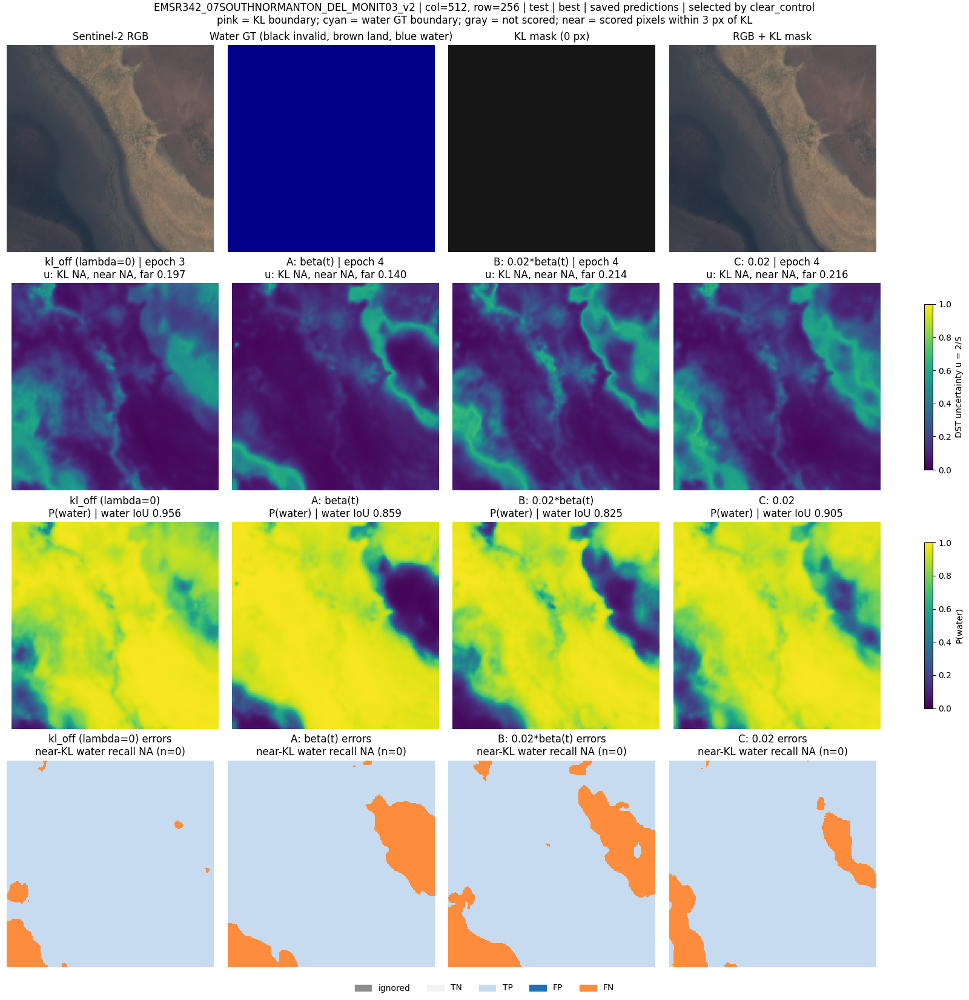
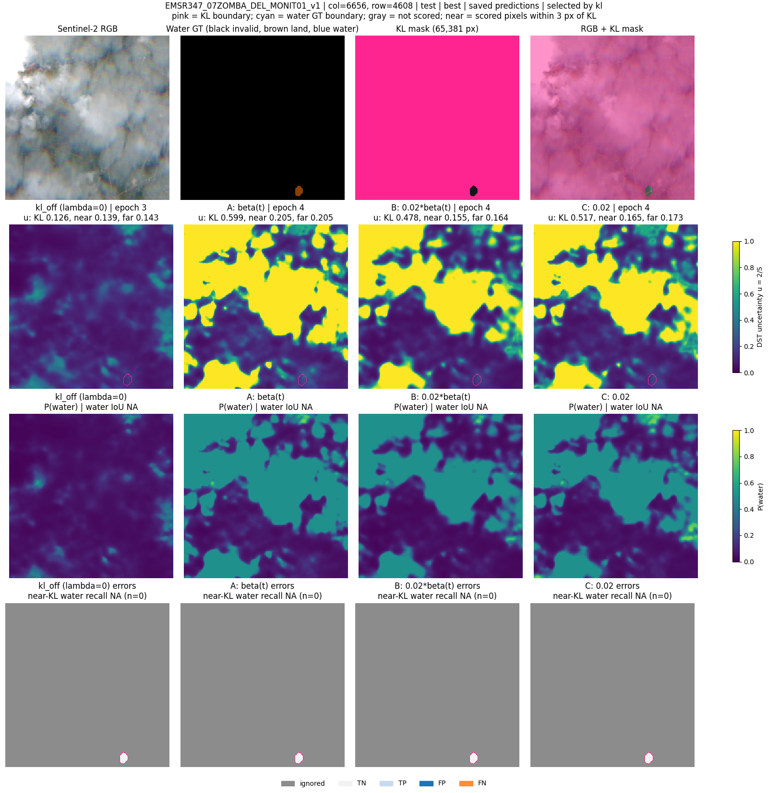
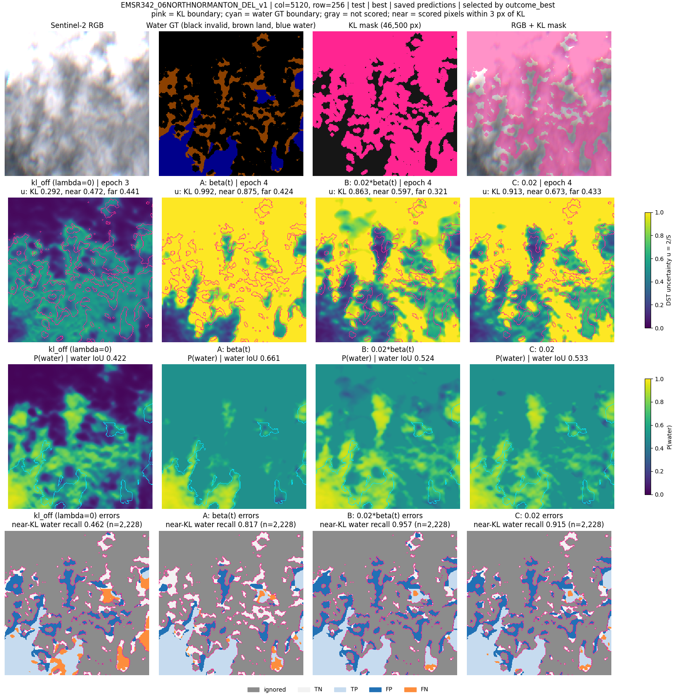
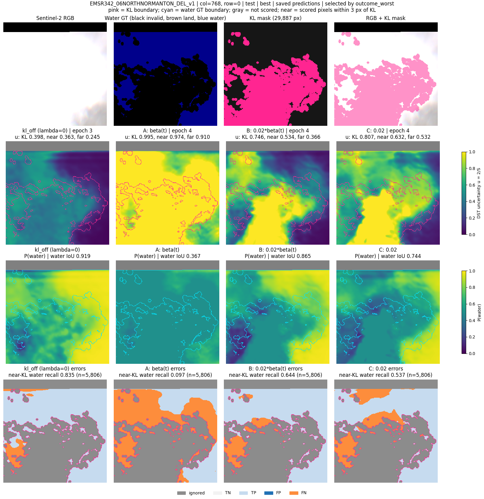
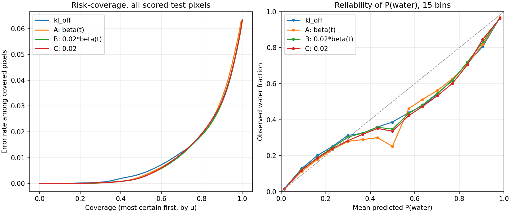

# Water-only EDL 的 invalid-pixel KL：ablation 結果

*2026-11-25 · WorldFloods v2 test split（18 個事件）· 四組，每組一個 seed*

## 摘要

- **invalid-pixel KL 確實在施加的位置提高了 u。** 在標註為雲的 KL 像素上，未加入此 KL 項時（kl_off）u 的中位數為 0.08。加入後，各組在 best checkpoint 的中位數為 0.74–1.00，在最後一個 epoch 均為 1.00。
- **主要結果（best checkpoint）：三個 KL 組的整體 recall 都較低。** C −0.006、A −0.022、B −0.028，95% CI 都不含 0。各組 IoU 差值的 95% CI 都包含 0，尚無法判定。在最後一個 epoch，整體指標差值的 CI 也都包含 0。
- **在 KL 像素附近，u 偵測錯誤的能力變差，兩種 checkpoint 都一樣。** 對於距離 KL 像素 3 px 以內的像素（near-KL），三個 KL 組用 u 偵測錯誤的 AP 都較低，6 個區間都不含 0。即使 C 在 near-KL 的錯誤比 kl_off 略少，這個現象仍然存在。
- **A（λ = β(t)）的 near-KL 指標退步最多。** 它的 AP 和 AUROC 下降最多，ECE 上升最多。B 和 C 相近。

## 實驗設定

| | |
|---|---|
| Loss | `mean_valid EDL(α) + λ(t) · mean_KL KL(Dir(α) ‖ Dir(1,1))`。`EDL` 本身已包含 misleading-evidence KL，權重為 β(t) = min(1, epoch/10)。 |
| KL 像素 | 輸入有效、位於事件 AOI 內，且水體標註為 invalid 的像素。在 test 上幾乎都標註為雲。 |
| 四組 | **kl_off**：λ = 0 · **A**：λ = β(t) · **B**：λ = 0.02 β(t) · **C**：λ = 0.02 |
| 訓練 | U-Net，輸入 6 個 S2 波段，輸出兩個 evidence channel，u = 2/S。從一個 cloud+water EDL 模型初始化。共 475 個事件、65,582 個 window，訓練 30 個 epoch，batch 64，seed 42。 |
| Checkpoint | **best**：validation 上 water BCE 最低的 epoch，kl_off 是 epoch 3，A/B/C 是 epoch 4（從 0 起算）。**last**：epoch 29。 |
| 評估像素 | 納入評估的像素共 167.1 M 個：標註為 land 或 water，且四組的預測都有效。**KL 鄰近像素（near-KL）**指納入評估、且距任一 KL 像素 3 px 以內的像素，共 2.5 M 個，來自 14 個有 AOI 事件中的 11 個。 |
| 統計方法 | P(water) > 0.5 判為水。Error detection 以 u 作為「預測 ≠ 標註」的分數。AUROC、AP、AURC 由 10,000 個 bin 計算，與精確值的差在 5.3e-4 以內。95% CI 來自配對的 event bootstrap，重抽 2,000 次。 |

## 結果

### 表 1. 主要指標，best checkpoint（主要結果）

**這張表在看什麼：** 各組先彙整所有納入評估的像素計算 test 指標，再針對其中的 near-KL 像素另行計算。最後一欄是 C − kl_off 及其 95% CI。

**怎麼解讀：** 名稱含「Error」的列，衡量 u 能不能把判錯的像素排在判對的像素前面。三個 KL 組的整體 recall 都較低，near-KL 的 error-detection AP 也都較低。

| 指標 | kl_off | A | B | C | C − kl_off [95% CI] |
|---|---|---|---|---|---|
| IoU ↑ | 0.836 | 0.818 | 0.817 | 0.828 | −0.008 [−0.016, +0.004] |
| Precision ↑ | 0.901 | 0.901 | 0.904 | 0.897 | −0.004 [−0.017, +0.017] |
| Recall ↑ | 0.921 | 0.899 † | 0.894 † | 0.915 | **−0.006 [−0.017, −0.001]** |
| ECE ↓ | 0.020 | 0.017 | 0.018 | 0.017 | −0.003 [−0.013, +0.008] |
| Error AUROC ↑ | 0.888 | 0.876 | 0.880 | 0.883 | −0.005 [−0.015, +0.001] |
| Error AP ↑ | 0.334 | 0.286 | 0.311 | 0.312 | **−0.022 [−0.066, −0.007]** |
| AURC ↓ | 0.0093 | 0.0108 | 0.0107 | 0.0099 | +0.0006 [−0.0004, +0.0053] |
| Near-KL recall ↑ | 0.883 | 0.861 | 0.888 | 0.885 | +0.002 [−0.040, +0.018] |
| Near-KL ECE ↓ | 0.022 | 0.072 † | 0.024 | 0.030 | +0.009 [−0.006, +0.035] |
| Near-KL error AUROC ↑ | 0.851 | 0.778 † | 0.824 | 0.814 | −0.038 [−0.088, +0.001] |
| Near-KL error AP ↑ | 0.346 | 0.230 † | 0.296 † | 0.270 | **−0.076 [−0.191, −0.030]** |

↑/↓：越高／越低越好。† 表示該組與 kl_off 差值的 95% CI 不含 0。**粗體**表示 C − kl_off 的 CI 不含 0。

### 表 2. 相同指標，最後一個 epoch（敏感度分析）

**這張表在看什麼：** 用每組 epoch 29 的權重重算表 1，讓四組的訓練長度相同。

**怎麼解讀：** C 與 kl_off 的整體指標差值，95% CI 都包含 0；A 的整體 error AP 仍低於 kl_off（†）。在 near-KL，C 的 recall、error AUROC 和 AP 較低，ECE 較高，CI 都不含 0。其中只有 AP 在 best 時也較低。

| 指標 | kl_off | A | B | C | C − kl_off [95% CI] |
|---|---|---|---|---|---|
| IoU ↑ | 0.814 | 0.815 | 0.817 | 0.816 | +0.001 [−0.001, +0.003] |
| Precision ↑ | 0.882 | 0.882 | 0.882 | 0.879 | −0.003 [−0.007, +0.003] |
| Recall ↑ | 0.914 | 0.914 | 0.917 | 0.919 | +0.005 [−0.001, +0.010] |
| ECE ↓ | 0.019 | 0.019 | 0.018 | 0.019 | −0.000 [−0.002, +0.002] |
| Error AUROC ↑ | 0.888 | 0.887 | 0.892 | 0.891 | +0.002 [−0.008, +0.014] |
| Error AP ↑ | 0.355 | 0.295 † | 0.346 | 0.343 | −0.011 [−0.054, +0.009] |
| AURC ↓ | 0.0104 | 0.0103 | 0.0098 | 0.0100 | −0.0004 [−0.0030, +0.0004] |
| Near-KL recall ↑ | 0.929 | 0.881 † | 0.927 † | 0.925 | **−0.005 [−0.006, −0.001]** |
| Near-KL ECE ↓ | 0.037 | 0.086 † | 0.058 † | 0.055 | **+0.018 [+0.003, +0.038]** |
| Near-KL error AUROC ↑ | 0.875 | 0.776 † | 0.845 | 0.840 | **−0.035 [−0.069, −0.008]** |
| Near-KL error AP ↑ | 0.423 | 0.209 † | 0.306 † | 0.283 | **−0.141 [−0.242, −0.063]** |

### 表 3. KL 像素上的 uncertainty

**這張表在看什麼：** 各組在 KL 項作用的像素上有多不確定。這些是 test 上 15.9 M 個標註為雲的 KL 像素。

**怎麼解讀：** kl_off 在雲下仍然很有把握。KL 三組把 u 推向 1，在最後一個 epoch 更明顯。

| | kl_off | A | B | C |
|---|---|---|---|---|
| u 中位數，best | 0.075 | 1.000 | 0.737 | 0.951 |
| u = 1 的比例，best | 0.000 | 0.643 | 0.398 | 0.490 |
| u 中位數，last | 0.079 | 1.000 | 1.000 | 1.000 |
| u = 1 的比例，last | 0.000 | 0.683 | 0.502 | 0.536 |

### 表 4. PAvPU，best checkpoint

**這張表在看什麼：** 以 3 × 3 的 patch 計算「準確」（patch IoU ≥ 0.9）與「有把握」（平均 u 低於門檻）一致的比例。每一列用不同的 u 門檻。這些數值只做描述，沒有 CI。

**怎麼解讀：**
- 三種門檻下的排名並不一致。
- 用預測有效像素計算各影像的 Q90 時，對 KL 三組不公平：雲上 u = 1 的像素會和門檻同值。
- 用標註有效像素計算的那一列，只納入標註為 land 或 water 的像素，所以沒有這個同值問題。

| u 門檻 | kl_off | A | B | C |
|---|---|---|---|---|
| Validation retention curve，90% | 0.810 | 0.839 | 0.794 | 0.808 |
| 各影像的 Q90（預測有效像素） | 0.840 | 0.813 | 0.807 | 0.815 |
| 各影像的 Q90（標註有效像素） | 0.843 | 0.837 | 0.824 | 0.836 |

### 圖 1. Risk–coverage 與 reliability，best checkpoint



**這張圖在看什麼：**
- 左圖是 retention curve：從 u 最低的像素開始依序保留，縱軸是已保留像素中的錯誤率。曲線下的面積就是表 1 的 AURC。
- 右圖比較預測的 P(water) 和實際的水體比例。

**怎麼解讀：**
- 在最有把握的 30% 像素中，KL 三組幾乎沒有錯誤，kl_off 則已經有一些有把握的錯誤。
- 大約從 60% coverage 開始，KL 三組的錯誤較多。
- 在最後一個 epoch，四條曲線幾乎重疊（附錄 C）。

### 圖 2–3. Case study，best checkpoint

**這兩張圖在看什麼：** 256 × 256 px 的 window，只依標註和 KL mask 挑選。
- 第 1 列：RGB、水體標註、KL mask、疊圖。
- 第 2–4 列：每一欄是一組，依序為 u、P(water) 和錯誤圖。

圖中灰色表示不納入評估，橘色是漏掉的水體（FN），深藍色是誤報（FP）。



**圖 2，EMSR264 VATOMANDRY：預期的行為。**
- kl_off 在雲下預測為水，u ≈ 0.16。
- KL 三組在雲上的平均 u 是 0.855–0.975。
- near-KL 的 u 從 0.055 升到 0.417（A）和 0.228（C）。
- Patch IoU 維持在 0.987–1.000。



**圖 3，EMSR342 NORTHNORMANTON：失敗的情況。**
- RGB 影像看來有雲覆蓋，但其中很大一部分標註為水體。
- 在 11,399 個 near-KL 水體像素上，recall 從 kl_off 的 0.996 降到 A 的 0.184、B 的 0.949、C 的 0.839。
- A 的 near-KL u 高達 0.98，且 P(water) 接近 0.5。這與「模型在外觀近似 KL 像素的位置抑制了 evidence」這項解釋相符。

## 限制

- **差異的來源。** 在 best checkpoint，kl_off 和 KL 三組來自不同的 epoch（3 對 4），β 也不同，所以這些差異不能完全歸因於 KL。
- **樣本數。** 每組只有一個 seed。Test 有 18 個事件，其中只有 10 個有 near-KL 水體像素。
- **AP 不等於錯誤數量。** AP 反映錯誤的排序，不是錯誤的多寡。C 在 near-KL 的錯誤其實比 kl_off 略少：best 時是 8.8% 對 9.0%，last 時是 9.0% 對 9.6%。

## 附錄

### A. 各事件的 water IoU（test）

**這張表在看什麼：** 各事件的 IoU，以免變化被整體的數值掩蓋。

**怎麼解讀：**
- 在 best，C − kl_off 介於 −0.17 和 +0.05 之間，C 在 18 個事件中有 8 個較好。
- 在 last，大部分變化在 ±0.015 以內，C 有 11 個較好。
- SOUTHNORMANTON 占全部納入評估的水體像素的 36%，所以主導了整體 IoU。
- † 表示沒有 AOI 的事件，test 時沒有 KL 像素。

| 事件 | 水體（M px） | kl_off | A | B | C | C − kl_off best | C − kl_off last |
|---|---|---|---|---|---|---|---|
| EMSR347 ZOMBA v2 | 0.13 | 0.751 | 0.596 | 0.627 | 0.581 | −0.169 | +0.055 |
| EMSR347 ZOMBA MONIT01 | 4.0 | 0.866 | 0.847 | 0.832 | 0.845 | −0.021 | +0.001 |
| EMSR286 ITUANGO NORTH † | 0.20 | 0.894 | 0.871 | 0.875 | 0.875 | −0.020 | +0.002 |
| EMSR342 SOUTHNORMANTON | 18.2 | 0.769 | 0.723 | 0.718 | 0.750 | −0.019 | +0.002 |
| EMSR347 MWANZA † | 0.69 | 0.676 | 0.648 | 0.672 | 0.662 | −0.014 | +0.014 |
| EMSR9284 YLITORNIO † | 0.42 | 0.766 | 0.815 | 0.748 | 0.757 | −0.009 | +0.001 |
| EMSR466 AOI01 | 0.90 | 0.746 | 0.725 | 0.720 | 0.738 | −0.008 | +0.007 |
| EMSR264 VATOMANDRY | 6.9 | 0.965 | 0.955 | 0.961 | 0.960 | −0.005 | −0.002 |
| EMSR419 AOI01 | 1.4 | 0.928 | 0.940 | 0.911 | 0.924 | −0.005 | −0.014 |
| EMSR438 AOI06 | 0.46 | 0.934 | 0.937 | 0.930 | 0.930 | −0.004 | −0.002 |
| EMSR438 AOI02 | 5.5 | 0.949 | 0.938 | 0.952 | 0.951 | +0.002 | +0.004 |
| EMSR273 GRILE | 0.29 | 0.922 | 0.930 | 0.927 | 0.928 | +0.006 | −0.002 |
| EMSR342 NORTHNORMANTON | 10.1 | 0.817 | 0.828 | 0.830 | 0.823 | +0.006 | +0.003 |
| EMSR422 AOI06 | 0.86 | 0.966 | 0.973 | 0.974 | 0.974 | +0.009 | −0.001 |
| EMSR333 PORTOPALO | 0.14 | 0.771 | 0.774 | 0.773 | 0.791 | +0.020 | −0.001 |
| EMSR286 ITUANGO SOUTH † | 0.06 | 0.788 | 0.831 | 0.834 | 0.824 | +0.036 | +0.000 |
| EMSR264 MIANDRIVAZO | 0.30 | 0.631 | 0.691 | 0.680 | 0.677 | +0.046 | −0.007 |
| EMSR333 RATTALORO | 0.22 | 0.787 | 0.839 | 0.816 | 0.835 | +0.048 | +0.006 |

### B. 其他 case study（best checkpoint）

**這幾張圖在看什麼：** 一個對照 window、一個厚雲 window，以及兩個依結果挑出的 window。版面和圖 2–3 相同。



**SOUTHNORMANTON，晴空、沒有 KL 像素。** KL 三組漏掉了混濁的水體，而且 u 很低。IoU：kl_off 0.956、A 0.859、B 0.825、C 0.905。在最後一個 epoch，這個事件的 C − kl_off 只有 +0.002。



**ZOMBA，厚雲。** kl_off 很有把握。KL 三組只在部分雲上達到 u = 1，KL 像素上的平均 u 是 0.48–0.60。




**依結果挑選：** C − kl_off 的 near-KL 水體 recall 差值最大（+0.45）和最小（−0.30）的 window。兩者來自同一個事件，所以在同一個場景裡，效果的方向就不一樣。

全部 35 個依標註挑選的 window 的總覽圖，以及整張事件的平面圖，在 `artifacts/eval/edl_water_kl_ablation/{case_studies/test_best_saved_20261125T082357Z,event_maps/test_best_20261125T110818Z}/`。

### C. 最後一個 epoch 的補充結果



**這張圖在看什麼：** 最後一個 epoch 的圖 1。四條 retention curve 和 reliability curve 幾乎重疊。

| PAvPU，最後一個 epoch | kl_off | A | B | C |
|---|---|---|---|---|
| Validation retention curve，90% | 0.810 | 0.820 | 0.811 | 0.798 |
| 各影像的 Q90（預測有效像素） | 0.835 | 0.811 | 0.816 | 0.813 |
| 各影像的 Q90（標註有效像素） | 0.836 | 0.835 | 0.839 | 0.838 |

整體 validation IoU（kl_off、A、B、C）：best 為 0.874、0.876、0.884、0.881；last 為 0.862、0.862、0.861、0.861。

### D. 重現方式

```bash
bash scripts/train/run_edl_water_kl_ablation.sh
bash scripts/analysis/run_kl_ablation_eval.sh                  # 加上 CHECKPOINT=last 即為最後一個 epoch
uv run python -m scripts.analysis.evaluate_kl_ablation --split val --check-exact
uv run python -m scripts.analysis.evaluate_kl_ablation --split test             # 加上 --checkpoint last
uv run python -m scripts.eval.plot_val_kl_maps --split test --pred-root artifacts/results/edl_water_kl_ablation
uv run python -m scripts.eval.plot_kl_event_maps --split test
```

- **數字：** `artifacts/results/edl_water_kl_ablation/{best,last}/evaluation/test/*.csv`。
- **Checkpoint：** `{best,last}/<arm>/checkpoint.txt`。
- **程式版本：** 即加入本報告的那個 commit。可用 `git log -1 --format=%H -- docs/edl_water_kl_ablation_report/report_zh.md` 查詢。
